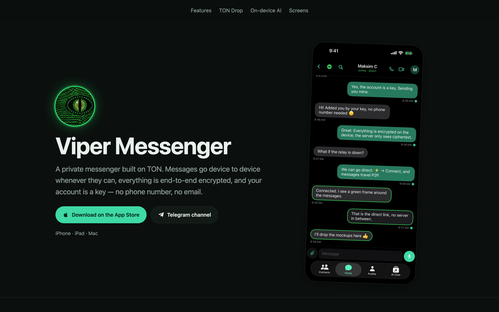
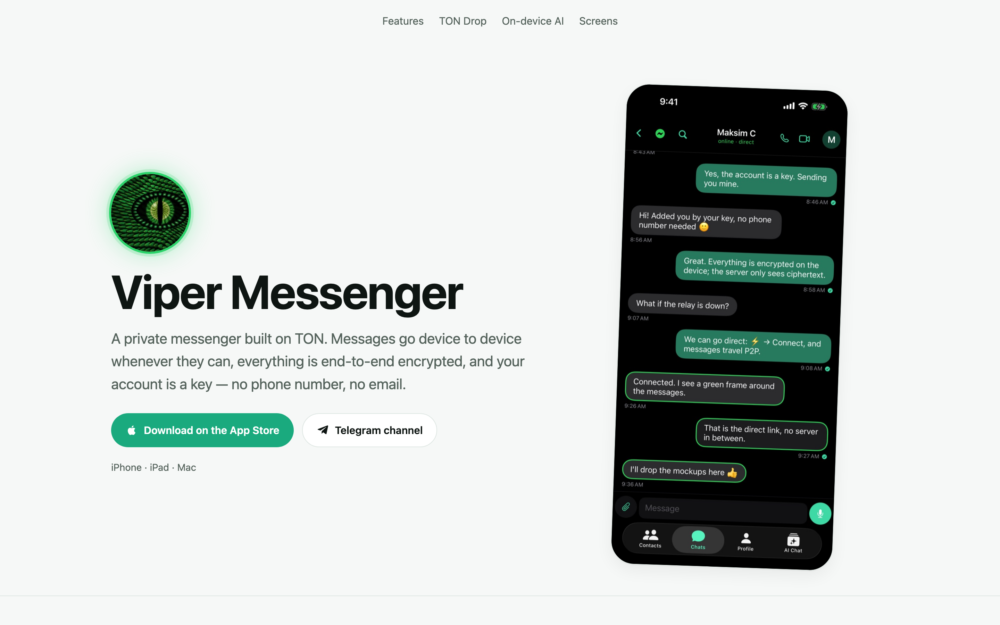
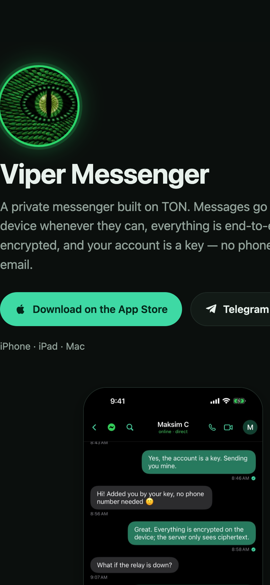
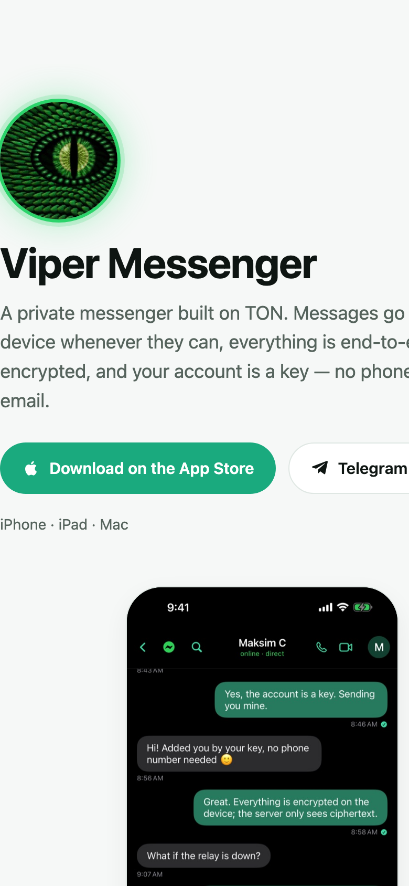

# viperfoundation.github.io

The open-source landing page of **Viper Messenger**: <https://viperfoundation.github.io/>

Viper Messenger is a private messenger built on TON. Messages go device to device whenever they can, everything is
end-to-end encrypted, and your account is a key: no phone number, no email.
[Viper Messenger on the App Store](https://apps.apple.com/us/app/viper-messenger/id6754181968) ·
[Docs](https://github.com/viperfoundation/Viper) · [Telegram](https://t.me/viperfoundation)

| Desktop, dark | Desktop, light |
|---|---|
|  |  |

| Mobile, dark | Mobile, light |
|---|---|
|  |  |

## What it is

One static page, no build step: `index.html` with inline CSS and JS, images in `img/`, animations in `lotties/noto/`.
It follows the system light/dark theme and works at phone width.

- **Sections:** what Viper does today, TON Drop (what works now and what is in progress), on-device AI, app screens.
- **Animations:** Google Noto Animated Emoji, the same ones Viper uses in onboarding, played with
  [lottie-web](https://github.com/airbnb/lottie-web) 5.12.2, served from `js/` (no third-party requests). They load only when scrolled into view
  and stay still when the system asks for reduced motion.
- **Screenshots:** Viper 1.5.34 screens rendered in the iOS simulator with sample data, and AI Chat on a Mac.

## Run it locally

```sh
git clone https://github.com/viperfoundation/viperfoundation.github.io
cd viperfoundation.github.io
python3 -m http.server 8765
# open http://localhost:8765/
```

## Deploy

GitHub Pages serves `main` from the repository root. Push to `main` and the site updates.
`404.html` keeps old links (such as `/landing`) landing on the home page.

## Credits

- Animated emoji: [Google Noto Emoji](https://googlefonts.github.io/noto-emoji-animation/), CC BY 4.0, unmodified
  (see `lotties/noto/NOTICE.md`).
- Older files (`static/`, `lotties/ton-pack/`) are the previous React build, kept in place and no longer used.

© Viper Foundation
